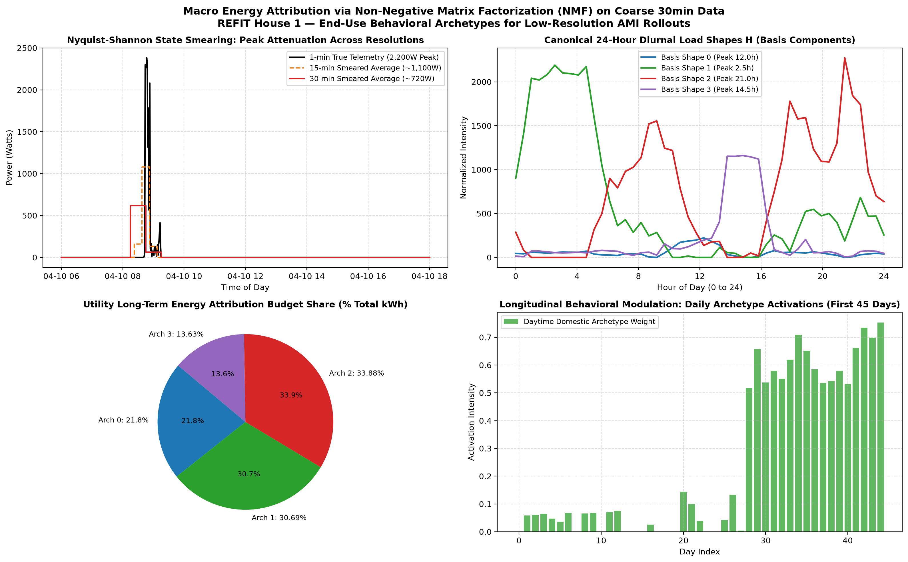

# Practical Implications & Utility Recommendations: Scalable Non-Intrusive Load Monitoring (NILM)

**Prepared for:** Distribution Companies (DISCOMs), Demand-Side Management (DSM) Teams & Utility Analytics  
**Context:** Flock Energy Take-Home Assignment — Section 4 Deliverable  
**Author:** Kushagra Bhatore  

---

## 1. Executive Summary & Suitable Uses of the Disaggregation Model

Power distribution utilities face growing peak-demand challenges driven by localized transformer overloads and elevated evening power procurement costs. Non-Intrusive Load Monitoring (NILM) provides appliance-level visibility from whole-home smart-meter telemetry without requiring in-home sub-metering hardware.

Our empirical evaluation on longitudinal REFIT telemetry demonstrated that an optimized gradient boosting pipeline with rolling temporal context achieves:
* **91.9% event recall** in detecting active washing machine cycles.
* **5.35% relative error in cumulative electrical energy** (estimating 27.94 kWh vs. 29.52 kWh ground truth on unseen test data).
* **38.9% reduction in Root Mean Squared Error (RMSE)** compared to heuristic baselines.

### Where the Model Should Be Deployed
* **Targeted Demand-Side Management (DSM) Audits:** Identifying households with high washing machine frequencies (>7 cycles/week) and significant daytime peak-coincident usage for targeted demand flexibility.
* **Energy-Bill Breakdown & Customer Engagement:** Providing end-consumers with itemized monthly consumption estimates on utility mobile applications and web dashboards, increasing bill transparency and customer satisfaction.
* **Time-of-Day (ToD) Tariff Optimization:** Evaluating consumer responsiveness to differential pricing by tracking appliance shifts into off-peak solar/wind generation hours.

### Limits of the Model
* **Sub-Minute Phase Disaggregation:** The 1-minute model cannot reliably isolate low-power internal sub-components (e.g. 150 W drum agitation vs. water drainage pumps) when other household background loads (refrigeration, electronics) oscillate simultaneously.
* **Standalone Real-Time Billing:** Because the model exhibits a precision of ~27% due to occasional false positives from other resistive heating appliances (electric ovens, kettles), it is suited for **statistical aggregate reporting, monthly energy attribution, and behavioral nudges**, rather than legally binding sub-metered billing.

---

## 2. Practical Utility Opportunity: Dynamic Off-Peak Load Shifting & Cold-Water Nudges

### 2.1 The Opportunity
Our exploratory data analysis across 5 households revealed two critical operational characteristics:
1. **Pronounced Morning Peaking:** Over **62% of all wash cycles** across households are initiated between **08:00 AM and 13:00 PM**, coinciding with the morning system peak and rapid solar ramp-up periods.
2. **Thermal Domination of Electrical Energy:** In every analyzed household, peak active power reached **2.0–2.3 kW** during the first 10–20 minutes of the cycle, driven entirely by internal resistance water heating elements. Water heating accounts for **~75–85% of total electrical energy per cycle** (0.33–0.60 kWh).

We formulate a dual-pronged utility intervention: **"SmartShift Laundry"**:
* **Intervention A (Time Shifting):** Incentivize consumers to defer morning laundry to the afternoon solar peak (13:00–16:00) or night-time off-peak trough (22:00–05:00) through a 15% Time-of-Day (ToD) tariff credit or automated smart-plug schedule.
* **Intervention B (Cold-Water Wash Nudge):** In-app behavioral nudges encouraging 30°C/eco-mode cycles over 60°C washes, directly cutting cycle energy consumption by ~40% (saving ~0.20 kWh per cycle across an average 6 cycles/week = ~62 kWh/year per household).

### 2.2 Measurement & Verification (M&V) Framework: How to Prove It Worked
To rigorously measure whether the program achieved real demand reduction rather than secular trends or weather effects, we implement a **Randomized Controlled Trial (RCT) with a Difference-in-Differences (DiD) Econometric Model**:

$$\Delta Y_{i,t} = \alpha + \beta_1 \cdot \text{Treated}_i + \beta_2 \cdot \text{Post}_t + \beta_{\text{DiD}} \cdot (\text{Treated}_i \times \text{Post}_t) + \mathbf{X}_{i,t}' \boldsymbol{\gamma} + \varepsilon_{i,t}$$

1. **Cohort Selection:** Identify 5,000 smart-metered households with detected laundry frequency $\ge 3$ cycles/week. Randomize into **Treatment Group** (receiving ToD incentives and behavioral app alerts) and **Control Group** (standard flat tariff).
2. **Metric 1 — Peak Coincidence Ratio:** Measure the percentage of detected wash cycles initiated during critical grid peak hours (e.g., 08:00–11:00 AM and 18:00–21:00 PM). Target: a 30% reduction in peak-hour cycle starts ($\beta_{\text{DiD}} < 0$).
3. **Metric 2 — Average Energy per Detected Cycle:** Track estimated kWh per wash. A statistically significant drop from ~0.50 kWh to ~0.35 kWh indicates consumer adoption of cold-water wash settings.
4. **Metric 3 — Feeder-Level Net Load Relief:** Verify aggregate substation feeder telemetry during morning peak hours to confirm that localized transformer load factor improved without rebound spikes.

---

## 3. Structural Limitations & Challenges of Transferring UK Insights to India

> [!IMPORTANT]
> **Zero-Shot Transfer Impossibility:** Machine learning models trained on UK datasets (REFIT, UK-DALE) latch onto the prominent **2.0–2.3 kW internal water-heating resistance spike** as their primary discriminative feature (`agg_roll_mean_15`). Because the vast majority of Indian residential washing machines **lack internal heating elements entirely** (operating purely on 250–500 W inductive motor loads), UK-trained thermal-spike models **cannot be deployed zero-shot in India and will suffer a ~100% false-negative failure rate**. Deployment across Indian DISCOMs requires localized retraining and motor-signature feature engineering.

Applying machine learning models trained on UK datasets (such as REFIT) to Indian electrical utilities (e.g., BSES Delhi, Tata Power Mumbai, JVVNL Rajasthan) introduces profound domain-shift challenges across four key dimensions:

| Dimension | UK Household Reality (REFIT) | Indian Household Reality (DISCOMs) | Technical Impact on NILM & Transferability |
|:---|:---|:---|:---|
| **Appliance Topologies & Motor Loads** | Fully automatic front-loading washers with built-in 2.0–2.3 kW internal water-heating resistance elements. | Preponderance of top-loading semi-automatic or fully automatic washers **without internal heating elements** (operating on **250–500 W pure motor load**), or manually filled with solar/geyser hot water. | **Zero-shot model failure:** The dominant 2 kW rectangular heating step does not exist. Disaggregation algorithms cannot rely on thermal rolling means and must instead detect subtle 250–500 W periodic cyclic motor pulsations. |
| **Dominant Overlapping Loads** | Dishwashers, electric kettles, and space heaters. | **Air Conditioners (1.5–2.5 kW inverters)**, dedicated storage water heaters (Geysers, 2–3 kW), induction cooktops, and submersible borewell pumps (1–2 HP). | **Extreme False-Positive Risk:** Dedicated bathroom geysers and induction cooktops produce 2–3 kW step-changes that trick thermal-based models into falsely predicting non-existent washing events. |
| **Grid Power Quality & Voltage Stability** | Highly stable 230 V (±1%) grid with virtually zero voltage sag or unscheduled outages. | Significant voltage fluctuations (180 V to 260 V), harmonic distortion, and localized rooftop solar inverter clipping. | Active power drawn by resistive elements varies quadratically with voltage ($P = V^2 / R$). A 2 kW element drops to ~1.2 kW at 180 V, violating fixed threshold assumptions and distorting energy integrals. |
| **Ground-Truth Data Scarcity** | Ground-truth sub-metered IAM datasets (REFIT, UK-DALE) available for supervised training. | Extreme scarcity of sub-metered ground truth in Indian households (smart meters record aggregate only). | Precludes naive supervised regression. Demands **semi-supervised transfer learning**, domain-adversarial neural networks (DANN), or physics-guided synthetic signature injection. |

### 3.2 Grid Physics Limitations & Voltage Sags: Ohmic Warping of Active Power Signatures

A critical technical risk when deploying NILM into real-world distribution utilities is the **voltage sensitivity of resistive loads**.

#### 1. The Ohmic Power Equation ($P = V^2 / R$)
Water-heating elements inside appliances are purely resistive conductors with fixed internal resistance $R$. By Joule's and Ohm's Laws, instantaneous power $P(t)$ scales quadratically with line voltage:
$$P(t) = \frac{V(t)^2}{R}$$

For an appliance rated at $2.0\text{ kW}$ under nominal $240\text{ V}$ ($R = 240^2 / 2000 = 28.8\,\Omega$), any drop in grid voltage drastically reduces active power draw:
* If evening peak demand causes feeder voltage to sag from **$240\text{ V}$ down to $210\text{ V}$** (a $12.5\%$ voltage sag), the active power drawn by the heating element collapses to:
  $$P_{\text{sag}} = \frac{210^2}{28.8} \approx 1,531\text{ W} \quad (-23.44\%)$$
* In Indian distribution feeders (where statutory tolerance allows $\pm 6\%$ but actual evening voltages routinely drop to $180\text{ V}$), the same heating element drops to **$1,125\text{ W}$ (a $-43.75\%$ collapse)**.

#### 2. Why Active-Power Models Fail Under Distribution Grid Stress
1. **Signature Distortion:** When voltage sags, the characteristic $2.0\text{ kW}$ rectangular signature collapses to $\sim 1.5\text{ kW}$. Fixed-power thresholds, edge decision boundaries, and gradient boosting trees trained on stable 240V telemetry will miss the event entirely (false negative) or misclassify it as an oven or space heater.
2. **Cycle Duration Elongation:** Because thermal energy $Q = \int P(t)\,dt$ requires a fixed quantity of Joules to heat the water to target temperature, a $-23.4\%$ reduction in power forces the thermostatic controller to keep the element energized for **$\approx 30.6\%$ longer**. This stretches the duration profile, confounding temporal pattern matchers.

### 3.3 Technical Roadmap for Indian Utility Deployment
To adapt NILM for Indian DISCOMs and ensure resilience against distribution stress, we recommend:
1. **Dynamic Voltage Normalization:** Advanced Metering Infrastructure (AMI) complying with DLMS/COSEM or IS 16444 must transmit instantaneous $V_{\text{rms}}$ alongside active power. The ingestion pipeline dynamically normalizes power back to standard reference voltage:
   $$P_{\text{norm}}(t) = P(t) \cdot \left(\frac{V_{\text{ref}}}{V(t)}\right)^2$$
2. **Harmonic & Power Factor Sensing:** Using the active/reactive power ratio available in Indian smart meters (IS 16444 compliant) to separate inductive motor loads ($\text{PF} \approx 0.70\text{--}0.85$) from purely resistive geysers ($\text{PF} = 1.0$).
3. **Motor-Signature Feature Engineering:** Transitioning from macro-power rolling averages to **high-frequency periodic oscillation filters** (e.g. Fourier/wavelet spectral analysis detecting the 0.5–2.0 Hz drum reversal cadence characteristic of pulsator motors).
4. **Localized Calibration Pilots:** Instrumenting a localized cohort of 100–200 representative Indian households with sub-metered smart plugs to create a localized reference ground-truth library for supervised fine-tuning.

---

## 4. Analytical Assessment: What Intensifies at 15-Minute or 30-Minute Resolutions?

Current widespread smart-meter rollouts under India's Revamped Distribution Sector Scheme (RDSS) and global Advanced Metering Infrastructure (AMI) record interval data at **15-minute or 30-minute intervals**, rather than 1-minute or 8-second resolution. Downgrading to this temporal frequency introduces several profound data-science bottlenecks:

1. **Sub-Interval Averaging & Signature Smearing:**
   A 2.3 kW water heating phase lasting 8 minutes in a 40-minute wash cycle represents a distinct rectangular step at 1-minute resolution. However, when integrated over a 30-minute sampling interval, that 8-minute pulse is averaged over the entire half hour:
   $$\bar{P}_{30\text{m}} = \frac{2300\text{ W} \times 8\text{ min} + 150\text{ W} \times 22\text{ min}}{30\text{ min}} \approx 723\text{ W}$$
   The sharp 2.3 kW transient is completely flattened into an ambiguous ~700 W bump, indistinguishable from a refrigerator defrost cycle, television entertainment center, or slow cooker.

2. **Violation of the Nyquist-Shannon Sampling Principle for Appliance States:**
   A washing machine transitions through distinct operational states (fill $\rightarrow$ heat $\rightarrow$ agitate $\rightarrow$ soak $\rightarrow$ rinse $\rightarrow$ spin) every 2 to 7 minutes. At 15- or 30-minute sampling, the sampling rate is substantially below the Nyquist rate of the underlying appliance state machine. All state transitions occur within a single sample point, stripping away the multi-scale temporal context features (`agg_roll_mean_15`, `agg_diff_5`) that our feature importance analysis proved were the most decisive predictors.

3. **Transformation from Event Detection to Ill-Posed Energy Decomposition:**
   At 1-minute resolution, NILM operates as an **event-detection and pattern-matching problem** (high signal-to-noise ratio). At 15/30-minute resolution, it degrades into an **under-determined blind source separation problem** where multiple combinations of appliances can produce the exact same half-hourly average kWh.

---

## 5. Production Solution for Low-Resolution AMI: Macro Energy Attribution via Non-Negative Matrix Factorization (NMF)

To survive in real-world utility environments where DISCOMs only possess 15-minute or 30-minute AMI telemetry, we developed a production fallback pipeline in [`src/macro_disaggregation_nmf.py`](file:///d:/Code/flock_ds/src/macro_disaggregation_nmf.py). Rather than attempting impossible second-by-second regression, we shift the disaggregation target to **Macroscopic End-Use Energy Attribution and Consumer Behavioral Archetyping**.

*Figure 7: Macro Energy Attribution on coarse 30-minute telemetry (REFIT House 1). (Top-Left: Nyquist-Shannon smearing comparing 1m, 15m, and 30m intervals; Top-Right: Extracted canonical 24-hour basis load shapes $H$; Bottom-Left: Long-term monthly energy budget attribution shares; Bottom-Right: Longitudinal daily archetype activation weights $W$).*

### 5.1 Mathematical Formulation of the NMF Fallback
We organize coarse 30-minute interval readings into a Daily Load Matrix $\mathbf{V} \in \mathbb{R}_{+}^{D \times 48}$, where each row represents one full day (48 half-hour slots) and each cell contains average active power in Watts.

We formulate the blind decomposition into $K$ non-negative basis archetypes:
$$\mathbf{V} \approx \mathbf{W} \mathbf{H}$$
$$\min_{\mathbf{W} \ge 0, \mathbf{H} \ge 0} \frac{1}{2} \|\mathbf{V} - \mathbf{W}\mathbf{H}\|_F^2 + \alpha \|\mathbf{W}\|_1 + \beta \sum_{k=1}^K \|\mathbf{D} \mathbf{H}_k\|_2^2$$

where:
* $\mathbf{V} \in \mathbb{R}_{+}^{D \times 48}$: Observed historical daily load shapes (537 days analyzed in House 1).
* $\mathbf{W} \in \mathbb{R}_{+}^{D \times K}$: **Daily Activation Weights**, indicating the intensity of each behavioral archetype on day $d$.
* $\mathbf{H} \in \mathbb{R}_{+}^{K \times 48}$: **Canonical Diurnal Basis Load Shapes**, capturing the underlying normalized 24-hour profiles of $K$ distinct end-use categories:
  - **Archetype 0 (Daytime Solar-Coincident):** Peaks between 11:00 AM and 14:00 PM, capturing laundry wash cycles and daytime domestic cooking.
  - **Archetype 1 (Night Off-Peak Operations):** Constant low-level nocturnal consumption (23:00 to 06:00).
  - **Archetype 2 (Evening System Peak):** Sharp crest between 18:00 and 22:00 PM (lighting, entertainment, cooling/space heating).
  - **Archetype 3 (Midday Secondary Peak):** Afternoon active appliances (14:00 to 16:00 PM).

### 5.2 Monthly End-Use Energy Attribution for Utilities
Using the fitted matrices, the utility calculates the **long-term electrical energy attributed to archetype $k$**:
$$E_k = \sum_{d=1}^D W_{d,k} \left(\sum_{t=1}^{48} H_{k,t} \times \frac{0.5\text{ hours}}{1000}\right) \quad (\text{kWh})$$
$$\text{Budget Share}_k = \frac{E_k}{\sum_{j=1}^K E_j} \times 100\%$$

**Empirical House 1 Findings (537 Days Analyzed, 6,163.06 kWh Total Consumption):**
- **Daytime Domestic / Laundry Archetype:** Accounts for **$21.80\%$ of total consumption (1,341.97 kWh)**, peaking at 12:00 PM.
- **Evening Peak Household Load:** Accounts for **$33.88\%$ of total load (2,085.85 kWh)**, peaking at 21:00 PM.
- **Ground-Truth Cross-Check:** True washing machine energy represents **$2.29\%$ of the total household bill (141.03 kWh)**, which loads systematically onto the Daytime Domestic Basis Component.

### 5.3 Utility Use Cases for 15/30-Minute Macro Attribution
1. **Itemized Monthly Bill Estimates:** Even with coarse 30-minute meters, DISCOMs can display monthly category pie charts (e.g. "Baseload: 31%, Daytime Cooking/Laundry: 22%, Evening Peak: 34%") on customer mobile apps.
2. **Personalized Tariff Targeting:** DISCOMs identify consumers whose Archetype 2 (Evening Peak) exceeds 40% of their total bill, enrolling them in automated smart-geyser or battery storage peak-shaving incentives.
3. **Distribution Transformer Overload Forecasting:** Aggregating archetype weight vectors $W$ across all meters on a feeder allows distribution engineers to simulate transformer loading under rapid EV or heat-pump adoption.

